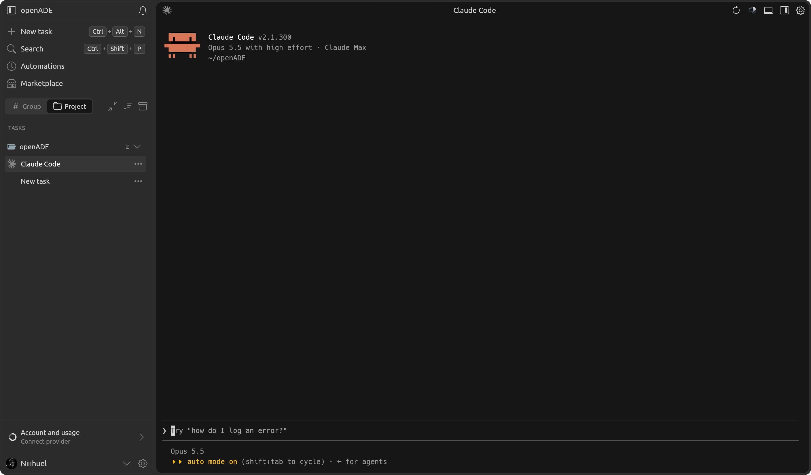
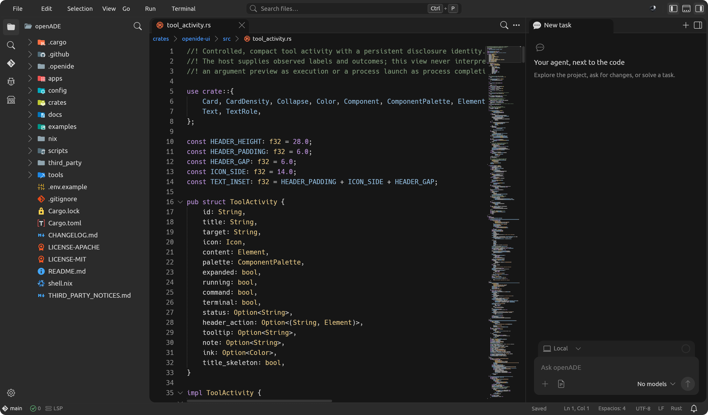

# openADE

A native agent development environment written in Rust: an agents window and an
IDE over the same workspace, built on its own UI framework
([limn](https://github.com/Niiihuel/limn)), its own agent harness and
configurable adapters for command-line agents such as Codex, Claude Code and
opencode.



The **IDE / Agents** switch changes the layout of the same workspace. The IDE
view brings together the file explorer, a tabbed editor, a bottom terminal and
the agent at the side, and keeps the documents and the session. See
[IDE workspace](docs/ide-workspace.md).



## Features

- **Agents.** A native Rust harness with its own provider catalog (OpenAI,
  OpenRouter, DeepSeek, Groq, Mistral, xAI and providers of your own), plus CLI
  profiles that run Codex, Claude Code or any agent found in `PATH`.
- **Conversation.** Grouped tool calls with their real states, a next-turn
  queue, editing a message while its turn runs, rewind, subagents, plans,
  images, Mermaid diagrams and a summary of each turn.
- **Approvals and permissions.** Plan and Build modes, per-tool permissions and
  command rules; every decision is saved durably before it reaches the runner.
- **Browser.** An embedded Chromium (CEF) the agent drives with
  Playwright-style tools, a visible pointer and per-site permissions.
- **Editor and preview.** A native code editor with language services, Vim mode
  and debugging; Markdown with code, preview and split views; images and PDFs.
- **Git.** Source control with grouped changes, branches and worktrees, commit,
  push, branch comparison, reviews and GitHub pull requests.
- **Automations and marketplace.** Scheduled tasks, skills, local plugins that
  add MCP tools ([example](examples/plugins/project-info/README.md)) and MCP
  servers with OAuth.
- **Dictation.** whisper.cpp transcribes the microphone on the machine itself on
  Linux and macOS; SAPI on Windows.
- **Interface.** English or Spanish, dark and light themes, keymap profiles,
  `Ctrl+K` for actions, sessions and files.

## Status

openADE is in active development. The original implementations live in
`crates/` and the desktop application in `apps/agents-window/`. The changes of
each version are in the [CHANGELOG](CHANGELOG.md).

## Building

It needs stable Rust (1.95 or newer) and the platform's native build tools.

```sh
cargo test --workspace
cargo run --profile desktop -p agents-window
```

On NixOS, `shell.nix` brings the C compiler, `pkg-config`, CEF and the libraries
the application links and loads:

```sh
nix-shell --run 'python3 scripts/build.py'
nix-shell --run ./target/desktop/agents-window
```

`scripts/build.py` builds with the optimized `desktop` profile, keeps the
incremental cache and removes artifacts with stale hashes from
`target/<profile>/deps/` after a successful build. `--run` opens the window and
`--profile dev` makes a quick debug build. Avoid running the interface
unoptimized: measuring text and drawing cost much more in the `dev` profile.

On Linux the project browser is an embedded Chromium (CEF) that the application
links. `shell.nix` provides it and downloads its 300 MB archive the first time.
Outside that shell, set `CEF_PATH` to build and put the CEF directory in
`LD_LIBRARY_PATH` to run; see [Embedded Chromium](docs/browser-cef.md#compilar-y-abrir).

Dictation needs `cmake`, `libclang` and, on Linux, the ALSA headers
(`libasound2-dev` or `alsa-lib`) to build whisper.cpp. The first time the
microphone is used it downloads the `ggml-small-q5_1.bin` model (181 MB) into
`models/` in the data directory; audio never leaves the machine.

On Windows the GNU toolchain builds without Visual Studio Build Tools:

```powershell
cargo +stable-x86_64-pc-windows-gnu test --workspace
cargo +stable-x86_64-pc-windows-gnu run -p agents-window
```

To try the interface without your usual tasks and automations, set
`OPENIDE_DATA_ROOT` to the absolute path of an isolated data folder before
starting the window.

## Providers and models

Settings → Providers and models keeps a catalog fed directly by the official
APIs of the registered providers, with a local cache of the last valid answer.
Providers that speak the OpenAI Responses or Chat Completions protocols can be
added with `provider-registry.json` in the data directory; each adapter declares
its endpoint, key variable and metadata routes, which the catalog cannot
change. A custom connection takes `OPENIDE_API_KEY`, `OPENIDE_API_BASE` and
`OPENIDE_MODEL`, and can run without a key against a local server.
`.env.example` lists the built-in key names; the application does not load
`.env` files by itself, and keys are never written to the session history.

Reasoning efforts are offered only when the exact model declares them and the
adapter can send them; other models stay on "Automatic". Codex CLI is a separate
route: openADE asks `codex app-server` for the models and efforts of the active
ChatGPT session, without reading or moving its credentials. CLI profiles use
each installed program's own authentication and are defined in
`cli-profiles.json`. See the [providers architecture](docs/providers-models-architecture.md)
and [CLI profiles](docs/cli-profiles.md).

## Architecture

See [docs/architecture.md](docs/architecture.md) for the map of components, and
the [native harness roadmap](docs/native-harness-roadmap.md) for the pending
capabilities and how they are verified. Most documents in `docs/` are written
in Spanish.

## References

- [Warp](https://github.com/warpdotdev/warp): `warpui` and `warpui_core` are MIT;
  the rest of that repository is AGPL v3. openADE's UI uses general concepts
  (views, elements, state, draw commands) with code written from scratch, and
  contains no AGPL code from Warp.
- [ZCode](https://github.com/zai-org/ZCode): a functional reference for the
  agent loop, tools, sessions and providers. openADE's code is written in Rust
  from scratch.
- [Codex](https://github.com/openai/codex) (Apache-2.0): its Rust harness's
  turn, tool and recovery contracts are studied; openADE keeps its own
  implementation.

Third-party code bundled in `third_party/` is listed in
[THIRD_PARTY_NOTICES.md](THIRD_PARTY_NOTICES.md).

## License

openADE is licensed under either of [MIT](LICENSE-MIT) or
[Apache-2.0](LICENSE-APACHE), at your option.

If openADE is useful to you, you can support it through
[GitHub Sponsors](https://github.com/sponsors/Niiihuel).
