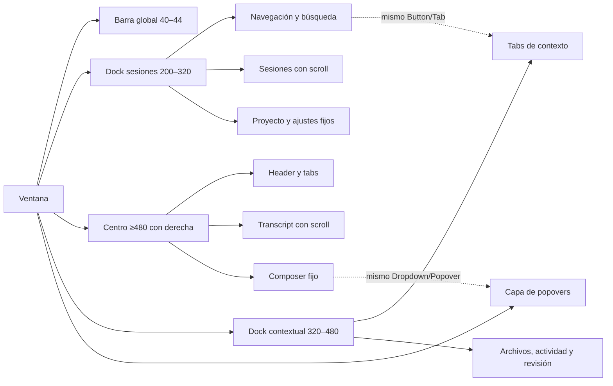

# Guía visual de OpenIDE basada en los mecanismos MIT de WarpUI

Esta guía fija el acabado que deben compartir sesiones, composer, archivos,
revisión de código y superficies flotantes. **Las medidas y colores de la sección
«Contrato de OpenIDE» son objetivos propios**, no valores atribuidos a Warp. El
repositorio abierto permite verificar *cómo* WarpUI compone y dibuja controles,
pero los temas y muchas vistas concretas del producto Warp están fuera de los
dos crates MIT. Las capturas facilitadas por el usuario sirven para comparar el
resultado visual, no para deducir constantes internas.

La revisión corresponde a `references/warp` en `5af88f49f84e70025f9c19e13f6b9ae64b624627`
([registro de referencia](references.md)). En adelante, todas las rutas `references/warp/...`
son locales y los números después de `:` son líneas de esa revisión.

## Mecanismos comprobados en WarpUI

| Mecanismo | Evidencia MIT | Decisión verificable en OpenIDE |
| --- | --- | --- |
| Estado separado de la descripción visual | `references/warp/crates/warpui_core/README.md:9-21,40-46` explica entidades, handles, vistas y elementos transitorios. | La selección de tab, apertura de menú, foco y scroll viven en el estado estable; reconstruir un elemento no reinicia una interacción. IDs de acción estables por entidad. |
| Estilos como contrato de componentes | `references/warp/crates/warpui_core/src/ui_components/components.rs:54-94,160-165` enumera fondo, borde, radio, fuente, padding y margen; `merge` aplica precedencia. | `Button`, `IconButton`, `Tab`, `Field`, `MenuItem` y `Popover` consumen la misma paleta y los mismos tamaños semánticos. Las vistas suministran contenido y acción, no recrean cada estado visual. |
| Un botón tiene variantes y estados reales | `references/warp/crates/warpui_core/src/ui_components/button.rs:78-110,129-155,263-285` define variantes y estilos normal, hover, presionado, activo y deshabilitado. | Cada variante declara sus estados en un único sitio. Hover y pressed cambian pintura; nunca cambian tamaño, padding ni alineación. `disabled` desactiva la acción además de atenuar el aspecto. |
| Icono monocromo y tamaño contenido | `references/warp/crates/warpui_core/src/elements/gui/icon.rs:14-15,29-48,65-101` define un icono de un color/opacidad, rasterizado al tamaño físico y centrado en su caja. `references/warp/crates/warpui_core/src/ui_components/button.rs:295-316` tiñe icono y texto con el color del estilo. | Usar una sola tinta semántica por icono del chrome. El SVG elegido debe ser monocromo desde el origen; recolorear las dos capas de un duotone con el mismo RGB deja distinta opacidad y **no** cumple esta regla. Caja visual de 16 px lógicos, rasterizada al DPI, dentro de un botón de 28–36 px. |
| Contenido y caja se miden por separado | `references/warp/crates/warpui_core/src/elements/gui/container.rs:16-27,55-73,105-165,272-288` combina margen, padding, fondo, borde, radio, sombra y overlay; `references/warp/crates/warpui_core/src/elements/gui/constrained_box.rs:12-58,61-72` impone mínimos y máximos. | Una fila de sesión puede tener 32 px de alto aunque su icono mida 16. El borde consume espacio; el trazo de foco se pinta sin cambiar la medida. Un composer crece hasta un máximo y luego desplaza su propio contenido. |
| Degradado como pintura | `references/warp/crates/warpui_core/src/elements/gui/container.rs:182-209` y `rect.rs:67-94` configuran un relleno degradado sin cambiar las restricciones de tamaño ni los eventos. | El desvanecimiento bajo el encabezado de sesión pertenece a la capa de pintura: no altera la altura del transcript, el scroll ni los hit targets. |
| Layout con restricciones explícitas | `references/warp/crates/warpui_core/src/elements/gui/flex/mod.rs:19-29,45-80,84-111,132-157,220-253,287-309` tiene ejes, spacing, alineaciones y reparto de espacio. `references/warp/crates/warpui_core/src/elements/gui/size_constraint_switch.rs:16-46,69-82,102-117` cambia composición según el ancho disponible. | Medir primero los docks fijos, después el centro. Colapsar el dock derecho antes de dejar el transcript demasiado estrecho. Las reglas responsive son de composición, no de truncar texto hasta hacerlo inútil. |
| Resize pertenece al dock | `references/warp/crates/warpui_core/src/elements/gui/resizable.rs:14-38,44-81,101-151` guarda ancho y límites en un handle y usa una zona de arrastre. | Cada divisor conserva su anchura entre sesiones; tiene hit target mayor que el divisor dibujado, cursor de resize y límites que protegen la columna central. |
| Overlay escapa del scroll | `references/warp/crates/warpui_core/src/elements/gui/stack/mod.rs:119-173,177-224` saca los hijos posicionados del cálculo del tamaño; `references/warp/crates/warpui_core/src/elements/gui/stack/overlay.rs:9-11,36-40` inicia una capa sin clip. `references/warp/crates/warpui_core/src/scene.rs:17-53,458-514` mantiene capas normales/overlay, clip y mapa de hit. | Menús, dropdowns y tooltips se anclan a un control real y flotan sobre los docks sin mover filas ni quedar cortados por el scroll. El clic exterior y Escape cierran, el foco regresa al disparador. |
| Tooltip y selector son composiciones pequeñas | `references/warp/crates/warpui_core/src/ui_components/button.rs:247-260,387-430` posiciona tooltip con desplazamiento de 8 px; `references/warp/crates/warpui_core/src/ui_components/segmented_control.rs:217-225,235-245,298-332` compone selección, icono, tooltip y estado deshabilitado. `references/warp/crates/warpui_core/src/ui_components/chip.rs:47-83` contiene icono, texto, cierre y paddings independientes. | `Tab`, chip y segment deben compartir estados, pero no usar una única geometría: header, barra compacta y lista tienen alturas distintas. La herramienta correcta conserva el mismo lenguaje visual. |
| Scroll tiene política propia | `references/warp/crates/warpui_core/src/elements/gui/new_scrollable/mod.rs:28-30,57-103,123-156` separa ejes y apariencia de scrollbar; `references/warp/crates/warpui_core/src/elements/gui/clipped_scrollable.rs:72-82,147-175,177-186` incluye scroll a posición y advierte que layout completo con clip es lento. `references/warp/crates/warpui_core/src/elements/gui/viewported_list.rs:44-55,66-103,175-183` maneja preservación de scroll en listas. | Sidebar, transcript y revisión desplazan por separado. Seleccionar una tarea conserva su ancla; streaming al final sólo sigue el nuevo contenido si el usuario ya estaba cerca del fondo. Las listas extensas se virtualizan antes de fijar una meta de rendimiento. |
| El renderer sostiene el detalle fino | `references/warp/crates/warpui/src/rendering/wgpu/renderer/frame.rs:118-175` recorta cada capa con scissor al DPI; `references/warp/crates/warpui/src/rendering/wgpu/renderer/rect.rs:93-143,151-189` prepara sombra, radios, borde y fondo como datos de la misma escena; `references/warp/crates/warpui/src/rendering/glyph_cache.rs:36-49,93-109` cachea glifos por clave, escala y alineación subpixel. | El backend actual de OpenIDE debe conservar radio y clip en todas las escalas, y rasterizar iconos y fuentes a la escala real. Cambiar de renderer no sustituye un diseño de componentes incoherente. |

Una observación importante: los crates MIT **no incluyen una tabla única de
colores, anchos de dock o alturas de todo el producto Warp**. Por ejemplo,
`Button::new` recibe estilos del llamador
(`references/warp/crates/warpui_core/src/ui_components/button.rs:159-180`) y
`TextInput` recibe un editor y estilos externos
(`references/warp/crates/warpui_core/src/ui_components/text_input.rs:5-28`).
Los 2 px de padding y 3 px de radio de un control segmentado
(`references/warp/crates/warpui_core/src/ui_components/segmented_control.rs:217-225`)
son medidas de ese componente, no un tema global. La pantalla profesional surge
de aplicar restricciones, tipografía y estados de forma consistente a cada
superficie.

## Contrato de componentes reutilizables

En `openide-ui`, `Component::render(self) -> Element` permite componer una
misma pieza con contenido y acciones de distintas vistas. La vista conserva
sus datos y los IDs estables; el componente resuelve geometría, paleta y
estados. `Button`, `Tabs`, `DropdownList`, `Popover`, `Tooltip` y `TreeRow<F>`
siguen ese contrato. `TreeRow<F>` recibe icono, título, trailing y una función
de acción genérica `F: FnOnce(Element) -> Element`. El explorador de Archivos
y las cabeceras de proyecto de Sesiones ya lo usan con IDs y alturas propios.
El genérico evita una asignación o despacho dinámico por fila.

Las guías de jerarquía son datos de presentación (`TreeGuides`) calculados a
partir de profundidades visibles, separados del modelo de archivos. Cada lane
ocupa 12 px lógicos; el último traza el codo y termina cuando la rama no tiene
otro hermano. En Archivos, las filas tienen 28 px de alto, el icono de 16 px se
centra en esa caja y el color de la guía usa un token neutro propio, distinto
del borde de superficies. La referencia de ZCode usa una cadencia de `0.75rem`
para su patrón de guías
(`references/ZCode/packages/ui/src/workspace-file-tree/hierarchyGuides.ts:3-17`);
la geometría y la composición Rust son propias de OpenIDE.

El motor reevalúa qué hit target está bajo el puntero después de un cambio de
layout, scroll o popover, aunque el mouse permanezca quieto. El estilo de hover
se aplica al target visible de mayor prioridad; la demora sólo controla el
tooltip. El anillo de foco corresponde a la navegación por teclado. Estas
reglas siguen la separación de mouse-over inmediato y hover demorado de
WarpUI (`references/warp/crates/warpui_core/src/ui_components/button.rs:263-285`)
y su verificación de cobertura por capas
(`references/warp/crates/warpui_core/src/elements/gui/hoverable.rs:410-443`).

`ScrollArea` aplica una política única a contenido normal y listas virtuales:
por defecto superpone un thumb de 5 px y deja el track transparente en reposo.
El contenido conserva su ancho al aparecer overflow. La zona de arrastre no
intercepta acciones bajo la parte transparente del carril; el thumb visible sí
permite arrastrar. Si un scroll anidado no puede desplazarse más, la rueda pasa
al contenedor exterior. Cada vista elige un tinte neutro del tema y mantiene su
ID de scroll estable. `ScrollbarAppearance::reserved()` permite reservar un
carril cuando una superficie lo necesite. La separación de aspecto overlay y
reservado procede como mecanismo de WarpUI MIT
(`references/warp/crates/warpui_core/src/elements/gui/new_scrollable/mod.rs:95-122,982-1038`);
la implementación y los tokens son propios de OpenIDE.

## Contrato de OpenIDE propuesto

Valores en **px lógicos**, medidos antes de multiplicar por el DPI. Se fijan
para que cualquier control nuevo se pueda implementar y revisar con las mismas
reglas. Se ajustarán con capturas a 100 %, 150 % y 200 %, preservando la
relación entre medidas.

| Rol | Objetivo de OpenIDE | Comprobación visual |
| --- | --- | --- |
| Icono del chrome | Un SVG Solar monocromo por acción; caja óptica **16 × 16**. Inactivo: tinta gris; activo: tinta del texto; destructivo: sólo ese estado usa rojo. | Dos iconos equivalentes de sidebar, tab, composer y dock tienen la misma caja y peso percibido. Ningún icono muestra segunda tinta ni una región intencionalmente semitransparente. |
| Área de acción | Icon button compacto 28 × 28; regular 32 × 32; acciones grandes 36 × 36. Icono siempre de 16, centrado. | Área clicable constante en hover, pressed y foco; nunca parece un icono de 24 dentro de una fila de 28. |
| Ritmo | Base de 4; espacios frecuentes 4, 8, 12, 16 y 24. Separaciones interiores de componente, no márgenes manuales distintos en cada pantalla. | Las filas de dos docks se alinean visualmente en altura y baseline. |
| Tipografía | Sans 13–14 para contenido UI, 12 para tabs y metadata, 11 para captions; monoespaciada 12 para código y rutas. Títulos de página 20–24; título de bienvenida 30–32 sólo en home. | Texto largo trunca por ancho **medido**, muestra tooltip o detalle accesible y no invade botones. En código se conserva selección/copia. |
| Superficies | Canvas `#161616`; centro `#202020`; dock lateral `#2B2B2B`; tarjeta `#292929`; popover `#333333`. Bordes `#3A3A3A` de 1 sólo donde separan regiones. Radios: fila 6–8, tarjeta 10–12, composer activo 20–24, popover 10. | Distinguir el panel seleccionado sin dibujar una caja alrededor de cada línea. El composer conserva sus cuatro esquinas curvas y no añade una banda rectangular de estado por debajo. Un borde no desaparece a 150 % DPI. |
| Estados | Sobre dock `#2B2B2B`, hover `#333333`, selected `#383838`; sobre centro `#202020`, hover `#292929`. Foco con anillo independiente; disabled conserva texto legible y no responde; busy añade indicador sin reemplazar etiqueta. | Navegar con Tab permite ubicar el foco aunque no haya mouse. Entrar/salir del hover no mueve texto ni iconos. |
| Tabs y menús | Tab compacto 28–32 de alto; menu item 32–36; popover ancho según contenido, mínimo 180 y máximo 360, con margen de 8 a la ventana. | Un menú puede abrirse desde sidebar, composer y dock derecho sin cambiar el layout, y se invierte arriba si falta espacio abajo. |
| Scroll y splitters | Scroll independiente por dock; thumb visible al interactuar y sin tapar contenido. Divisor dibujado de 1, hit target de 6–8; mínimo central 480 para tres docks. | Arrastrar un divisor no corta compositor o controles del header. La rueda en un dock no mueve otro. |

### Composición de la ventana

El diagrama es el **objetivo visual**. En el estado actual, la barra de título
del sistema cumple parte de la barra global y el dock derecho suele estar
oculto en home; también se repliega cuando el ancho no permite conservar 480
px centrales.

1. **Barra global:** altura objetivo 40–44. Marca/estado, búsqueda y acciones
   globales son una franja compartida. No duplica en grande el nombre de la
   aplicación en el header izquierdo.
2. **Dock izquierdo:** ancho por defecto 264, mínimo 200, máximo 320. Contiene
   navegación, proyectos y sesiones con filas 28–32. La búsqueda y la acción
   nueva comparten geometría de control; selección, unread y agente son señales
   distintas. Su footer permanece fijo y sólo la lista desplaza. Al plegarlo,
   el centro gana ese ancho sin perder altura; el control para reabrirlo se
   integra en el header o flota sobre el centro sin empujar el contenido.
3. **Centro:** ocupa el espacio restante, mínimo útil 480 cuando se muestran
   tres docks. La sesión activa presenta un encabezado compacto y continuo con
   un desvanecimiento sobre los primeros píxeles del transcript; éste queda acotado a una
   columna legible de 720–800 y centrado. El composer permanece anclado al
   fondo como una tarjeta flotante de cuatro esquinas curvas, crece con varias
   líneas hasta 220 y luego desplaza su entrada; la
   respuesta y las herramientas desplazan detrás de él sin quedar ocultas.
   Home es una variante de este centro, no otra escala de controles.
4. **Dock derecho:** 320–480 según ancho, con tabs de Contexto, Archivos,
   Actividad y Revisión. Comparte marco y franja superior con el centro; sólo un
   divisor de 1 px los separa. Header fijo, contenido con scroll propio. La revisión
   muestra archivo → hunk → línea y conserva numeración, estados de cambio y
   acciones por archivo. Los controles de tabs son el mismo componente que
   en el centro, configurado con otra densidad.
5. **Ventana estrecha:** mostrar el dock derecho sólo si
   `ancho - sidebar - derecho - divisores >= 480`; ocultarlo primero al reducir
   la ventana. Bajo 800, reducir sidebar; bajo el mínimo de centro, ofrecer
   sidebar como overlay. El composer siempre conserva input, backend y botón
   de envío utilizables. Plegar el izquierdo no abre automáticamente un derecho
   que estaba oculto por ancho; éste se puede abrir luego de forma explícita.

Los anchos son una **propuesta para OpenIDE**, inferida de la necesidad de
mantener una columna central legible y de las capturas del usuario. La fuente
MIT sólo demuestra las primitivas necesarias para aplicar límites, resize y
reglas responsive
(`references/warp/crates/warpui_core/src/elements/gui/constrained_box.rs:28-58`,
`references/warp/crates/warpui_core/src/elements/gui/resizable.rs:44-81`,
`references/warp/crates/warpui_core/src/elements/gui/size_constraint_switch.rs:16-46`).

## Diferencias concretas con el estado actual

| Prioridad | Evidencia en OpenIDE al revisar | Cambio implementable | Criterio de aceptación |
| --- | --- | --- | --- |
| P0 | **Implementado:** `DrawCommand::Icon` transporta una sola tinta; el host usa Solar Linear y cachea una máscara por icono/tamaño físico. La API de dos colores se eliminó. | Completar capturas de sesión, revisión y archivos; ajustar sólo iconos cuyo peso óptico difiera en la caja de 16. | Capturas de los cuatro docks sin segunda tinta; raster de los SVG válidos a distintas escalas. |
| P0 | **Implementado en flujos principales:** `Button`/`IconButton` semánticos comparten variantes y estados, usados en sidebar, home, sesión y navegación de ajustes. Quedan controles secundarios construidos directamente con `Element`. | Migrar esos controles al mismo contrato al tocarlos, sin perder IDs ni geometría específicos. | Un cambio de altura/hover en el componente se refleja en más de un dock; tests de acciones y disabled. |
| P0 | **Implementado:** `dock_layout` mantiene 480 px centrales con tres columnas y repliega la derecha bajo 1016 px. El header de sesión aún requiere compactación. | Revisar header y dock con capturas a 900, 1200 y 1600 px. | Composer y header sin truncación crítica; dock derecho vuelve a su ancho persistido al ensanchar la ventana. |
| P1 | **Implementado en acciones compartidas:** `theme::hover_for(surface)` aclara cada superficie en lugar de aplicar un gris global que oscurecía el sidebar. Algunas vistas heredadas siguen usando `theme::HOVER`. | Migrar sus estados en el mismo pase que cada componente. | Sidebar y centro muestran progresión visual base → hover → seleccionado. |
| P1 | **Implementado en `session_row`:** título medido, metadata del agente separada, indicador unread propio, selección estable y `Icon::More` de Solar Linear. La lista de sesiones usa `UniformList` virtualizada. | Verificar listas grandes y todos los menús de sesión con captura. | Títulos largos y Unicode no chocan con menú; 1.000 filas conservan scroll fluido. |
| P1 | **Implementado en popovers y dropdowns:** Tab queda dentro del menú; flechas y Home/End recorren opciones visibles; Escape y clic exterior devuelven foco al trigger. | Hacer que la navegación por teclado desplace opciones fuera del viewport en listas largas y completar menús de otras vistas. | El menú abre sobre scroll y conserva retorno de foco incluso después de seleccionar. |

## QA para declarar un componente terminado

- Captura de base, hover, pressed, selected, focus, disabled y busy con la
  misma geometría. Comparación de rectángulos en píxeles lógicos; sólo cambian
  tinta, fondo, borde o sombra.
- Capturas de home, sesión larga, menú abierto, revisión de código y archivo a
  100 %, 150 % y 200 % DPI. No se aceptan iconos borrosos, recortes de texto,
  bordes de grosor desigual ni popovers fuera de la ventana.
- Teclado: Tab/Shift+Tab, Enter/Espacio, Escape, flechas en tabs/listas, foco
  visible, retorno al disparador al cerrar. Mouse: clic, drag de splitter,
  wheel independiente por dock y clic exterior de popover.
- Carga: 1.000 sesiones, transcript con streaming y diff grande. Medir tiempo
  de layout y pintura; si depende de toda la lista, virtualizar. Comprobar que
  cambiar de tarea no pierde scroll, foco ni menú de otra tarea.
- Cada componente tiene al menos un ejemplo integrado en dos contextos
  distintos y pruebas de los IDs de acción, del estado deshabilitado y de los
  límites de layout. El test visual verifica pixeles; el test de árbol verifica
  interacción.

## Licencia y límite de la referencia

`references/warp/README.md:52-56` y los manifests
`references/warp/crates/warpui_core/Cargo.toml:7` y
`references/warp/crates/warpui/Cargo.toml:7` declaran MIT para esos dos crates;
el resto de Warp se declara AGPL v3. Esta guía usa exclusivamente esos crates
para fundamentar mecanismos. **No autoriza copiar vistas de producto,
integraciones, temas ni assets de las áreas AGPL.** Si se incorpora código MIT
en lugar de implementarlo de forma original, se debe preservar su aviso MIT.
